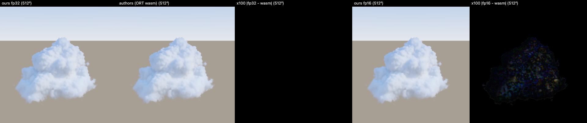
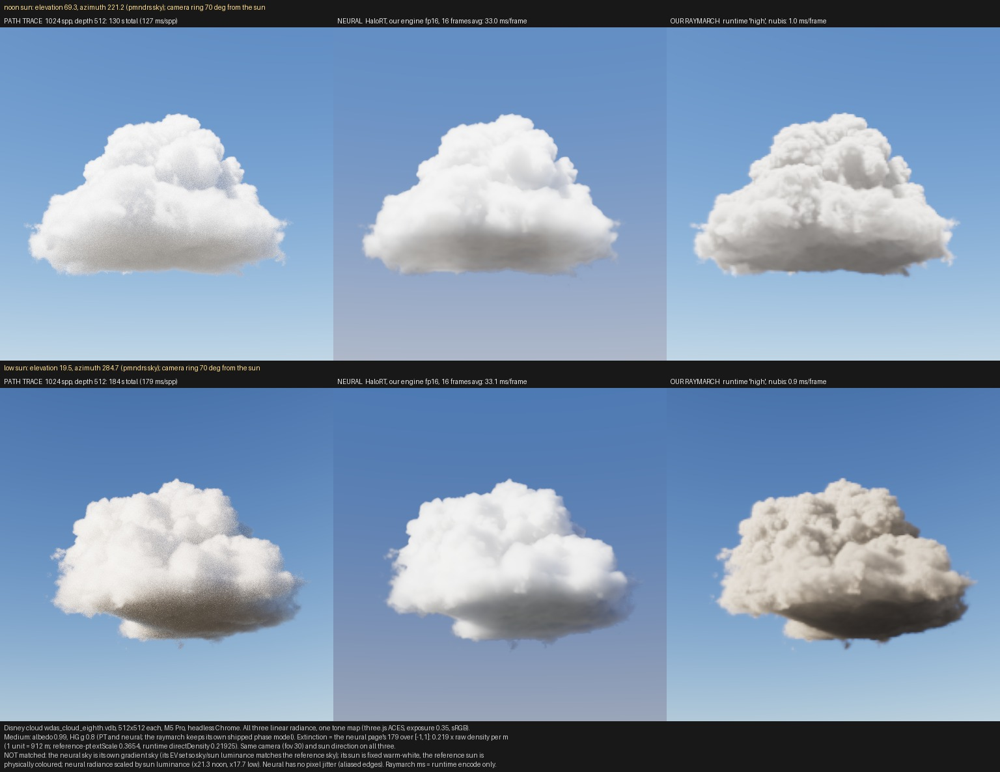

# Neural clouds — what we tried and what we found

Experiment run 2026-11-23 to 2026-11-25. **Outcome: neural rendering is not a
speed route for our clouds. The work is stopped and nothing from it is on
main except this research record.**

The question was whether a network could give us faster or better cloud
rendering than our raymarcher, starting from a web port of HaloRT
(Leonard & Westermann, arXiv 2611.12103). Field summary: `README.md`. How
HaloRT works: `halort-anatomy.md`. One note per cited paper: `refs/`.

## Where the code is

Local branches only (the repository has no remote yet):

| Branch / tag | Holds |
| --- | --- |
| `claude/webgpu-neural-clouds-5e8baf`, tag `neural-halort-port-end` | The HaloRT port: WGSL feature pass (`experiments/neural/feature-pass.ts`), our hand-written WGSL network engine (`experiments/neural/engine/`), lab page `/neural/`, plan `docs/neural/PLAN.md`, status `work/neural/`, logs `work/logs/N*.md` |
| `neural/bake-experiments` | The same plus the baked-imposter plan and budget measurements: `docs/neural/BAKE.md`, `docs/neural/FOLLOWUPS.md`, `work/logs/B0.md` |

Weights and the authors' demo files are local only under
`artifacts/research/neural/` (the demo repository has no licence).

## What was built

- **Feature pass:** HaloRT's 14 per-pixel channels in one WGSL compute pass on
  our VDB density texture. Matches the authors' features for matched settings.
- **Network engine:** HaloRT's U-Net with block attention in hand-written
  WGSL, 88 dispatches in one submit, six passes as one batch. Output equals
  the authors' to 1.3e-6 in fp32.
- **Live page:** features, network and blend on the GPU with a switch beside
  ONNX Runtime.

## Numbers (M5 Pro)

| What | Cost |
| --- | --- |
| HaloRT network only, 512², ONNX Runtime Web | 135–180 ms |
| HaloRT network only, 512², our engine | 36 ms fp32, 23 ms fp16 |
| HaloRT whole frame, 512², our engine fp16 | 33 ms |
| Our raymarch, Disney cloud, 192² to 512² | about 1 ms (flat; fixed cost or timer floor) |
| Path trace, same cloud, 512², 1024 samples | 130–184 s |
| Tiny network (64→5×64→3), portable WGSL fp16 | 1.7 ms at 128², 6.3 ms at 256², 24.6 ms at 512² |
| Tiny network (64→3×32→3), estimated by multiply count | about 0.35, 1.3 and 5 ms |
| Full-sky cloudscape (`/hzd/`, 1280×720, about half the frame cloud) | ultra 15 ms (cloud pass 14.6), high 7–8 ms |

One early idea was wrong and is recorded so it is not repeated: the gap
between ONNX Runtime and a hand-written engine is not dispatch overhead
(about 6.5 µs per dispatch); it is kernel speed.

## Picture: path trace, neural, raymarch

Mean brightness against the path trace, sun matched:

- **Noon.** Neural is closest in brightness (lit top +11 %, underside −25 %)
  but softer, with less detail inside the body. The raymarch is the sharpest
  but grey: lit faces −46 %.
- **Low sun.** Neural is too flat (body +25 %, shallow shadow band). The
  raymarch has the better shadow shape and colour but lit faces −57 %.

Not matched: the neural sky and sun colour, the raymarch's phase model. The
owner treats the brightness and tone differences as tuning, not as a reason
for a network.

## Conclusions

1. **HaloRT is the wrong kind of network for speed.** It runs a full image
   U-Net six times, about 50,000 multiplies per pixel per pass. It costs
   about 33 times our raymarch for one cloud and is softer.
2. **A network is faster only where it replaces something expensive.** The
   papers win against path tracing (minutes to milliseconds). Our raymarcher
   already uses a cheap lighting formula, so there is nothing expensive for a
   lighting network to replace.
3. **Per-cloud baking (MRBNN, Olajos 2026) does not beat the march either.**
   A tiny network per pixel costs at least a thousand multiplies plus feature
   reads; it ties the march at best, needs a bake per cloud, and cannot
   handle procedural or changing density. The bake was planned and not built.
4. **A full sky does cost real time** (about 15 ms at ultra), so drawing
   distant clouds without marching is worth pursuing, with methods that cost
   a texture read or two per pixel: billboards, octahedral imposters, or a
   baked 3D texture with lighting stored in it.
5. **What a network could still offer is not speed:** one small relightable
   imposter in place of an atlas per sun direction (memory), or lighting
   closer to a path trace (quality).

## If this is ever reopened

- Judge against the raymarcher (milliseconds, and the picture beside the path
  trace), never against ONNX Runtime or a paper's own baseline.
- Subgroup-matrix kernels made the tiny network about eight times faster in
  the path tracer's tests, but they need a Chrome flag. That is the one
  measurement that could change conclusion 3.
- Reusable pieces: the WGSL network engine (conv, norm, attention, weight
  import), the path tracer's `packages/mlp` trainer, the three-way comparison
  route on `/reference-pt/` (`runtimeTiming`).
